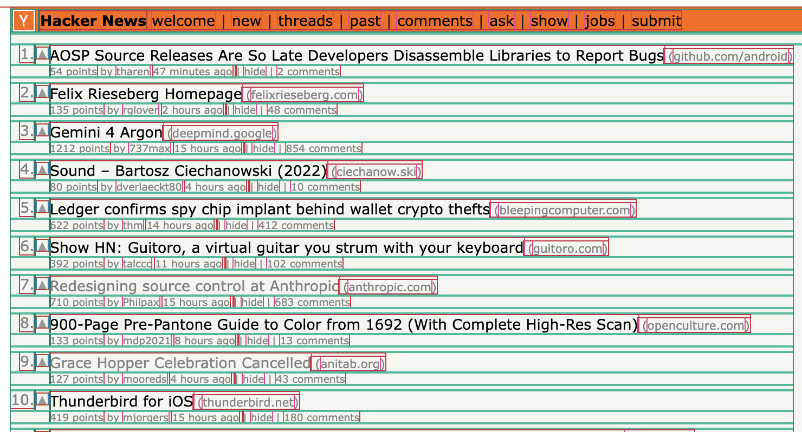

# pestctrl

Outline every element on the current page.

Click the toolbar icon. Each element gets a colored outline. Click again and the outlines go away. A reload clears them too.



Outlines use the CSS `outline` property, so the page's box model stays as it was. Colors follow the element type: a `div` and a `p` are different colors, and anything not in the named list uses one fallback color.

## Install

`bun install`, then `bun run build`. In Chrome, open `chrome://extensions`, turn on Developer mode, choose Load unpacked, and select the `extension/` directory.

The source of the service worker is TypeScript in `src/`. The build writes `extension/background.js`. Chrome loads that file. It is generated and gitignored.

## Behavior

- The click affects the active tab, including its iframes.
- The toolbar badge reads `ON` while the outlines are applied.
- Pages Chrome will not let an extension modify (`chrome://`, the Chrome Web Store, the New Tab page) stay unchanged, and the badge stays empty.
- A navigation drops the outlines. Click the icon again on the new page.
- Elements inside a shadow tree are left alone.

## Permissions

`activeTab` and `scripting`. There is no host permission, so the extension cannot see a tab until you click the icon. It does not make network requests.

There is no popup, keyboard shortcut, hover inspector, or settings page.

## Develop

```sh
bun test
bun run typecheck
bun run build
```

`fixtures/page.html` is a static page for a manual check: nested regions, an iframe, and an open shadow root.

Publishing and CI are not set up yet. A later release job can zip `extension/` after `bun run build`.

## Credit

The idea comes from [Pesticide](https://github.com/mrmrs/pesticide) by Adam Morse. pestctrl is a new extension.
